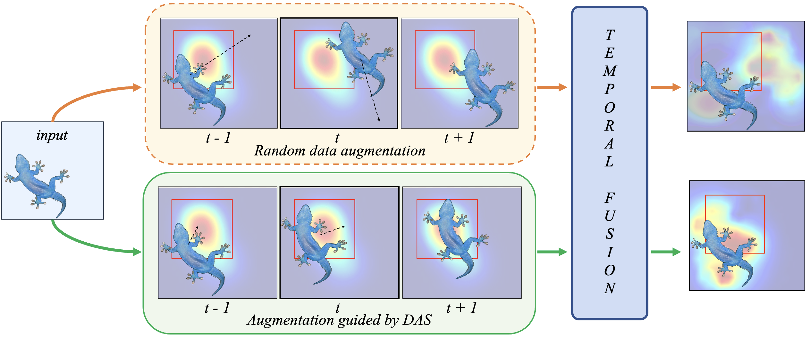
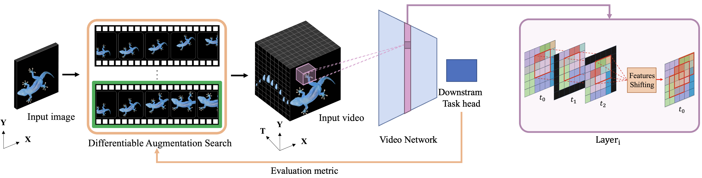
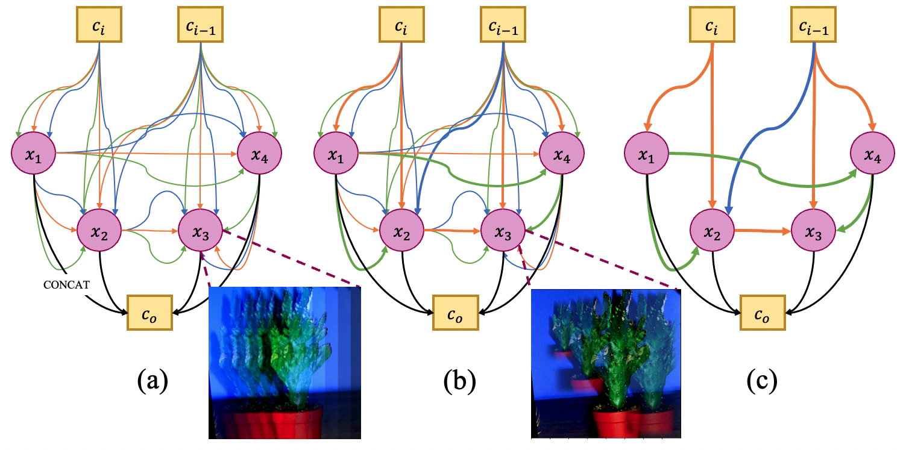
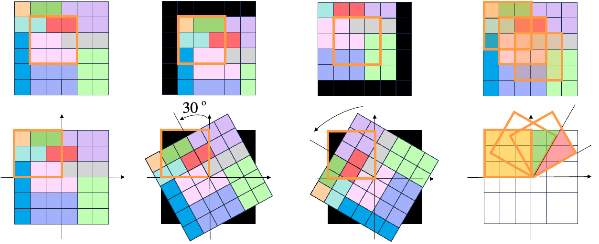

# MovingImages (Your Image Is My Video)

Code for generating "moving image" videos from static image datasets and training image/video classifiers on them (image-to-video augmentation).

[](https://doi.org/10.1109/CVPR52733.2024.00557)
[](https://arxiv.org/abs/2403.15194)

## Paper

**Your Image Is My Video: Reshaping the Receptive Field via Image-to-Video Differentiable AutoAugmentation and Fusion**
Sofia Casarin, Cynthia I. Ugwu, Sergio Escalera, Oswald Lanz
*IEEE/CVF Conference on Computer Vision and Pattern Recognition (CVPR), 2024, pp. 5829-5839.*
[arXiv](https://arxiv.org/abs/2403.15194) | [DOI](https://doi.org/10.1109/CVPR52733.2024.00557)

The paper introduces Differentiable Augmentation Search (DAS), which learns affine transformations that turn a single image into a short synthetic video. A lightweight video backbone then fuses the transformed frames using a temporal shift mechanism. This reshapes the receptive field of the model without relying on a deeper image backbone, improving image classification (ImageNet) and semantic segmentation (Pascal VOC, Cityscapes) at comparatively low model complexity.

<p align="center"></p>

*Conceptual representation of the approach: the receptive field (RF) is reshaped by affine transformations optimized through Differentiable Augmentation Search (DAS), keeping more context.*

<p align="center"></p>

*Method overview: an input image goes through a DAS cell that generates a video, processed by a video network with a temporal shift mechanism that reshapes the RF; predictions are fused and fed back to the DAS cell.*

<p align="center"></p>

*DAS cell: multiple augmentation operations per edge are applied jointly and optimized during training, then the cell is discretized with a perturbation-based approach.*

<p align="center"></p>

*RF reshaping for translation (top) and rotation (bottom); the last column shows the effect of the temporal shift mechanism.*

Figures are from the paper ([arXiv HTML version](https://arxiv.org/html/2403.15194v1)).

## Citation

```bibtex
@inproceedings{casarin2024your,
  author    = {Casarin, Sofia and Ugwu, Cynthia I. and Escalera, Sergio and Lanz, Oswald},
  title     = {Your Image Is My Video: Reshaping the Receptive Field via Image-to-Video Differentiable AutoAugmentation and Fusion},
  booktitle = {Proceedings of the IEEE/CVF Conference on Computer Vision and Pattern Recognition (CVPR)},
  year      = {2024},
  pages     = {5829--5839},
  doi       = {10.1109/CVPR52733.2024.00557}
}
```

## Repository structure

```
movingimages/
  data_generation/   moving_dataset.py, ss_moving.py: turn images into moving videos
  models/            ResNet image/video models, GSF/TSM modules (gateshift.py)
  ops/               basic ops (consensus module)
  utils/             datasets, transforms, helpers, Tiny-ImageNet loader
scripts/             training entry points (image, video, augmented, self-supervised, optuna)
assets/              figures for the README
```

## Installation

```
pip install -r requirements.txt
```

## Usage

Run everything from the repository root, as modules:

```
python -m movingimages.data_generation.moving_dataset --dataset <name>
python -m movingimages.data_generation.ss_moving --dataset <name>
python -m scripts.video_train --dataset <name> --root <path> --lr <lr> --wd <wd> --epochs <n>
python -m scripts.image_train
python -m scripts.augmented_train
python -m scripts.self_supervised_train
python -m scripts.optuna_video_train
python -m scripts.optuna_classification
```

Use `--help` on each module for its options.

## Data

Generated datasets are expected in folders such as `moving_cifar-10/`, `moving_mnist/`, `moving_emnist/`, `moving_fashion-mnist/` with `train_videofolder.txt` / `val_videofolder.txt` lists (see `movingimages/utils/helpers.py`). Some scripts contain hard-coded absolute data paths from the original author's machine (e.g. `scripts/augmented_train.py`, `scripts/image_train.py`) that must be edited.

## License

No license file is provided in the original repository.
